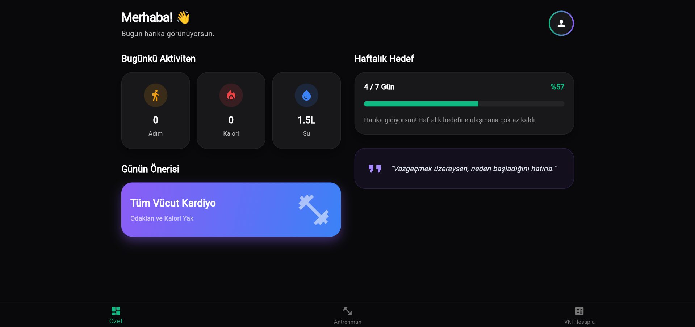
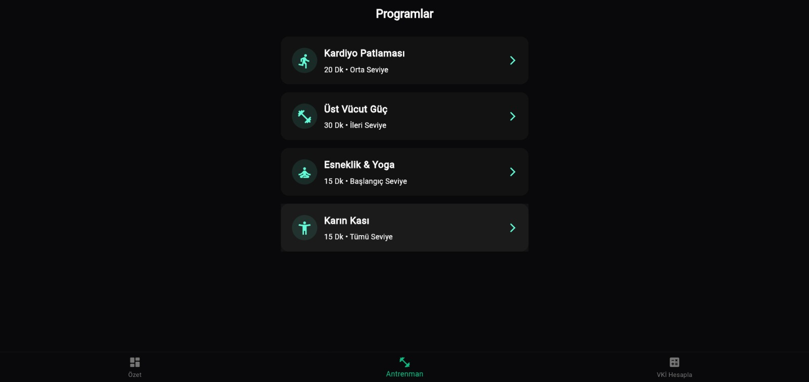
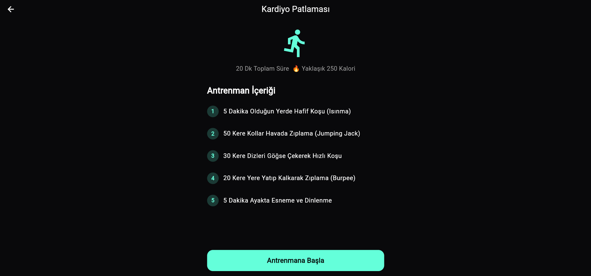
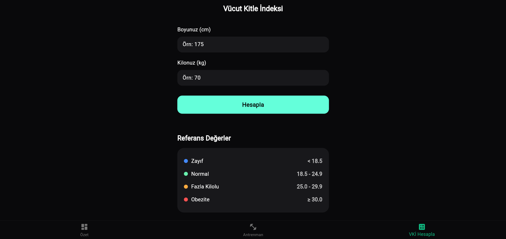

#  FitLife - Fitness & Aktivite Takip Uygulaması

**FitLife**, kullanıcıların günlük aktivitelerini takip etmelerini, seviyelerine uygun antrenman programlarını zamanlayıcı eşliğinde uygulamalarını ve Vücut Kitle İndeksi (VKİ) hesaplamalarını sağlayan modern bir Flutter mobil uygulamasıdır.

---

##  Temel Özellikler

-  **Aktivite Özeti Paneli:** Adım, yakılan toplam kalori ve su tüketimi gibi günlük verileri şık kartlarla izleme.
-  **Haftalık Hedef Takibi:** İlerleme çubuğu (progress bar) ile haftalık motivasyon takibi.
-  **Özelleştirilmiş Antrenmanlar:** Farklı zorluk seviyelerinde (Başlangıç, Orta, İleri) hazırlanmış detaylı egzersiz listeleri.
-  **İnteraktif Antrenman Zamanlayıcısı:** Geri sayım sayacı, duraklat/sıfırla kontrolleri ve tamamlandığında otomatik kalori ekleme mekanizması.
-  **Vücut Kitle İndeksi (VKİ) Hesaplayıcı:** Boy ve kilo girdilerine göre anlık VKİ skoru ve referans kategori durum değerlendirmesi.
-  **Modern Koyu Tema:** Material 3 tabanlı, göz yormayan karanlık arayüz tasarımı.

---

##  Ekran Görüntüleri

<div align="center">
  
  
  
  
</div>

---

##  Kullanılan Teknolojiler

- **Flutter & Dart**
- **Material 3 Design**
- **State Yönetimi:** ValueNotifier & ValueListenableBuilder
- **Asenkron Programlama:** Timer (Kronometre mantığı)

---

##  Proje Yapısı

```plaintext
fitness_application/
├── lib/
│   └── main.dart            # Uygulama yapısı, arayüzler ve state yönetimi
├── screenshot/
│   ├── giris.png
│   ├── antrenman.png
│   ├── antrenman_icerigi.png
│   └── indeks_hesaplama.png
├── pubspec.yaml             # Bağımlılıklar ve yapılandırma
└── README.md                # Proje dokümantasyonu